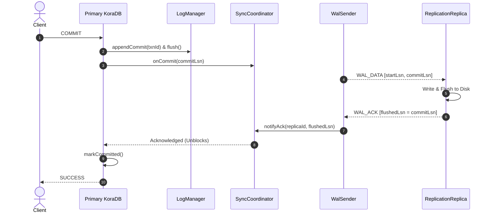

# Primary/Replica WAL-Based Replication — Design Document

## 1. What Problem Does It Solve?

In single-node database deployments, hardware failures, operating system crashes, or disk corruptions can cause catastrophic data loss and prolonged system outages. Furthermore, high-traffic analytical or reporting workloads running against a single primary node compete for system resources with mission-critical write transactions.

To achieve enterprise-grade **high availability**, **read scalability**, and **fault tolerance**, KoraDB implements physical Write-Ahead Log (WAL) streaming replication in **Milestone 12**:

1. **High Availability & Zero Data Loss**: Physical WAL records are streamed continuously from the Primary to one or more Replicas. In synchronous mode, write transactions are guaranteed durable across independent disks before acknowledging client commits.
2. **Read Scalability**: Analytical queries, reporting dashboards, and read-heavy workloads can be offloaded to read-only replicas without impacting primary write throughput or acquiring read locks.
3. **Seamless Failover & Promotion**: When a primary node becomes unavailable, any replica can be promoted to become the new primary node, instantly enabling read-write access.
4. **Resilient Catch-Up**: Replicas that start late or reconnect after network partitions automatically catch up from the exact byte offset (LSN) where they left off.

All replication networking, binary framing, consensus acknowledgment, and WAL replay are implemented **from scratch using Java 21 standard library** with zero external dependencies.

---

## 2. Architecture & Streaming Topology

```
┌─────────────────────────────────────────────────────────────────────────────┐
│                             PRIMARY NODE                                    │
│                                                                             │
│   Client Connections                                                        │
│           │                                                                 │
│           ▼                                                                 │
│    StatementExecutor ──► TransactionManager ──► LogManager (Local Disk WAL) │
│                                 │                       ▲                   │
│                       SyncReplicationCoordinator        │                   │
│                                 │                       │ read WAL stream   │
│                                 ▼                       │                   │
│                      ReplicationMaster (Port 8766) ─────┘                   │
│                                 │                                           │
│               Spawns Java 21 Virtual Threads per Replica                    │
│                                 │                                           │
│               ┌─────────────────┴─────────────────┐                         │
│               ▼                                   ▼                         │
│       WalSender (Replica 1)               WalSender (Replica 2)             │
└───────────────┬───────────────────────────────────┬─────────────────────────┘
                │                                   │
      Replication Wire Protocol           Replication Wire Protocol
    [Magic: 0x52][Type][Len][Data][CRC32] [Magic: 0x52][Type][Len][Data][CRC32]
                │                                   │
                ▼                                   ▼
┌───────────────────────────────────┐ ┌───────────────────────────────────┐
│           REPLICA NODE 1          │ │           REPLICA NODE 2          │
│                                   │ │                                   │
│  WalReceiver (Background Thread)  │ │  WalReceiver (Background Thread)  │
│               │                   │ │               │                   │
│         Decodes WAL               │ │         Decodes WAL               │
│               ▼                   │ │               ▼                   │
│          WalApplier               │ │          WalApplier               │
│     • Replays Updates onto Pages  │ │     • Replays Updates onto Pages  │
│     • Replays DDL onto Catalog    │ │     • Replays DDL onto Catalog    │
│     • Advances Applied LSN        │ │     • Advances Applied LSN        │
│     • Updates Txn Commit State    │ │     • Updates Txn Commit State    │
│               │                   │ │               │                   │
│    Sends WalAck (Flushed LSN)     │ │    Sends WalAck (Flushed LSN)     │
│               │                   │ │               │                   │
│   Local Client Reads (MVCC)       │ │   Local Client Reads (MVCC)       │
│   • Rejects INSERT/UPDATE/DELETE  │ │   • Rejects INSERT/UPDATE/DELETE  │
│   • Allows Lock-Free SELECT       │ │   • Allows Lock-Free SELECT       │
└───────────────────────────────────┘ └───────────────────────────────────┘
```

### Core Components

- **`ReplicationMaster`**: Binds to a dedicated replication port, listening for replica connections. Spawns a `WalSender` virtual thread for each connecting replica.
- **`WalSender`**: Performs initial handshake validation, checks starting LSN, streams historical WAL records from disk, and listens to live flush notifications via `WalFlushListener` for real-time streaming.
- **`SyncReplicationCoordinator`**: Intercepts primary transaction commits when synchronous replication is active. Holds commit completion until the required number of replicas acknowledge flushing the commit LSN to disk, with timeout handling.
- **`ReplicationReplica`**: Manages the lifecycle of a replica node, coordinating the receiver and applier background loops. Enforces read-only database query execution and handles `promote()` to primary role.
- **`WalReceiver`**: Establishes TCP connection to the master, performs protocol handshakes, streams binary frames, checks CRC32 integrity, and sends periodic ACKs and heartbeat responses.
- **`WalApplier`**: Replays decoded `LogRecord` entries in sequential LSN order onto the local replica's storage pages and catalog, updating committed and aborted transaction state for MVCC queries.

---

## 3. Binary Replication Wire Protocol

All communication between Primary and Replica uses a custom, compact binary framing protocol with end-to-end CRC32 data integrity verification.

### Frame Layout

```
 0                   1                   2                   3
 0 1 2 3 4 5 6 7 8 9 0 1 2 3 4 5 6 7 8 9 0 1 2 3 4 5 6 7 8 9 0 1
+-+-+-+-+-+-+-+-+-+-+-+-+-+-+-+-+-+-+-+-+-+-+-+-+-+-+-+-+-+-+-+-+
|  Magic (0x52) |   Type (1B)   |          Payload Length       |
+-+-+-+-+-+-+-+-+-+-+-+-+-+-+-+-+-+-+-+-+-+-+-+-+-+-+-+-+-+-+-+-+
|       (Payload Length cont.)  |        Payload Bytes ...      |
+-+-+-+-+-+-+-+-+-+-+-+-+-+-+-+-+-+-+-+-+-+-+-+-+-+-+-+-+-+-+-+-+
|  ...                          |         CRC32 Checksum        |
+-+-+-+-+-+-+-+-+-+-+-+-+-+-+-+-+-+-+-+-+-+-+-+-+-+-+-+-+-+-+-+-+
|     (CRC32 Checksum cont.)    |
+-+-+-+-+-+-+-+-+-+-+-+-+-+-+-+-+
```

- **Magic Byte (1 Byte)**: Always `0x52` (ASCII character `'R'`). Validates protocol compatibility and rejects malformed traffic.
- **Message Type (1 Byte)**: Identifies the replication message semantics:
  - `0x01` (`HANDSHAKE_REQ`): Replica requests connection with its ID, mode, and starting LSN.
  - `0x02` (`HANDSHAKE_RESP`): Master confirms connection and reports cluster state.
  - `0x03` (`WAL_DATA`): Master sends a batch of serialized WAL bytes between start and end LSN.
  - `0x04` (`WAL_ACK`): Replica acknowledges received, written, and flushed LSN positions.
  - `0x05` (`HEARTBEAT`): Liveness probe sent periodically between master and replica.
  - `0x06` (`HEARTBEAT_ACK`): Pong response with monotonic timestamp for lag estimation.
  - `0x07` (`SNAPSHOT_REQ`): Request for catalog table snapshot during initial catch-up.
  - `0x08` (`SNAPSHOT_RESP`): Schema and metadata snapshot payload.
- **Payload Length (4 Bytes)**: Big-endian 32-bit signed integer specifying the size of the payload in bytes.
- **Payload Bytes**: Encoded message contents.
- **CRC32 Checksum (4 Bytes)**: Big-endian IEEE 802.3 CRC32 checksum computed over the entire payload. If received CRC32 does not match, the receiver drops the frame with `CorruptedFrameException`.

---

## 4. Replication Modes

KoraDB supports three replication modes configured via `ReplicationMode`:

| Mode | Commit Latency | Durability Guarantee | Description |
|---|---|---|---|
| **`ASYNC`** | Minimal (Local disk only) | Eventual | Primary commits immediately after local disk flush. WAL records are sent to replicas asynchronously in the background. |
| **`SYNC`** | Network RTT + Replica Flush | Zero Data Loss | Primary holds commit until connected replicas write and flush the commit LSN to disk. If no replicas ACK within timeout, commit fails. |
| **`SEMI_SYNC`** | Network RTT or Timeout | High Durability | Primary attempts synchronous acknowledgment. If a timeout occurs, primary can degrade gracefully to async mode to maintain availability. |

### Synchronous Commit Sequence



If a synchronous commit times out before the replica acknowledges:
1. `SyncReplicationCoordinator` throws `TimeoutException`.
2. `TransactionManager` intercepts the exception prior to marking the transaction committed.
3. The transaction is safely aborted and rolled back, ensuring client transactions are never falsely confirmed.

---

## 5. DDL Replication & Durability

Replication is not limited to page-level data updates. Schema evolution commands (`CREATE TABLE`, `DROP TABLE`) are first-class citizens in KoraDB's WAL:

1. **`DdlLogRecord` (Opcode 9)**: Contains the SQL definition of schema modifications.
2. **Durability on Master**: `DiskCatalog.createTable()` and `dropTable()` write a `DdlLogRecord` to `LogManager` and flush the WAL.
3. **Replay on Replica**: `WalApplier` decodes the `DdlLogRecord` and invokes local catalog methods with `suppressWalLogging = true` to prevent recursive re-logging on the replica.

---

## 6. Read-Only Replica Guarantees & MVCC

Replicas in KoraDB are strictly read-only:

- **Mutation Protection**: Any attempt to execute `INSERT`, `UPDATE`, `DELETE`, `CREATE TABLE`, `DROP TABLE`, or `CREATE DATABASE` on a replica throws `ReadOnlyReplicaException`.
- **Lock-Free Consistent Reads**: `SELECT` queries execute against the replica's local storage using MVCC Snapshot Isolation.
- **Txn Visibility Alignment**: `WalApplier` tracks transaction commit and abort records from the Primary and registers them in the replica's `TransactionManager`. Read views on the replica accurately reflect only primary-committed data versions without acquiring read locks.
- **Pure-Reader Abort Isolation**: Transactions that only perform `SELECT` queries never write undo logs and do not pollute the `abortedTxnIds` map, avoiding ID collisions with primary write transactions.

---

## 7. Failover, Promotion & Reconnect

### Promotion to Primary
When a primary node fails or requires maintenance, any replica can be promoted:

```java
// On the replica node
replica.promote();
```

Upon promotion:
1. The background `WalReceiver` loop disconnects and terminates cleanly.
2. `NodeRole` transitions from `REPLICA` to `PRIMARY`.
3. `DiskCatalog.setSuppressWalLogging(false)` re-enables local WAL logging.
4. Mutation queries (`INSERT`, `UPDATE`, `DELETE`, `CREATE`) are immediately unlocked.

### Historical Catch-Up
When a replica connects for the first time or reconnects after a temporary network partition:
1. `WalReceiver` sends a `HandshakeRequest` containing its current `appliedLsn`.
2. `WalSender` compares `appliedLsn` against the master's WAL history.
3. If historical segments exist, `WalSender` reads all historical WAL records directly from the WAL log file and streams them sequentially.
4. Once the replica has caught up to the live WAL head, `WalSender` switches seamlessly to event-driven push via `WalFlushListener`.

---

## 8. Replication Status & Lag Monitoring

Administrators and monitoring services can inspect replication status on both Primary and Replica nodes:

### On the Replica
```java
ReplicationStatus status = replica.getStatus();
System.out.println("Role: " + status.role());                // REPLICA
System.out.println("Mode: " + status.mode());                // ASYNC or SYNC
System.out.println("Connected: " + status.connected());      // true
System.out.println("Byte Lag: " + status.byteLag());        // masterFlushed - replicaApplied
System.out.println("Latency: " + status.lagLatencyMs() + "ms");
```

### On the Primary
```java
Map<String, ReplicaInfo> replicas = master.getReplicas();
for (ReplicaInfo info : replicas.values()) {
    System.out.println("Replica " + info.replicaId() + ":");
    System.out.println("  Flushed LSN: " + info.flushedLsn());
    System.out.println("  Last ACK: " + info.lastAckTimeMs());
}
```

---

## 9. Usage Examples

### Primary Node Setup
```java
KoraDB primaryDb = new KoraDB(Path.of("/var/koradb/primary"));
primaryDb.execute("CREATE DATABASE production");
primaryDb.execute("USE production");

DiskCatalog catalog = (DiskCatalog) primaryDb.getCatalog();
ReplicationMaster master = new ReplicationMaster(
    ReplicationMasterConfig.onPort(8766),
    catalog.getLogManager(),
    catalog::getDatabaseTableFiles
);
master.start();

// Standard writes on Primary
primaryDb.execute("CREATE TABLE orders (id INT, customer VARCHAR, total DOUBLE)");
primaryDb.execute("INSERT INTO orders VALUES (101, 'Alice', 250.0)");
```

### Replica Node Setup
```java
KoraDB replicaDb = new KoraDB(Path.of("/var/koradb/replica"));
replicaDb.execute("CREATE DATABASE production");
replicaDb.execute("USE production");

ReplicationReplica replica = new ReplicationReplica(
    replicaDb,
    ReplicationReplicaConfig.of("replica-node-1", "primary-host", 8766, ReplicationMode.ASYNC)
);
replica.start();

// Consistent reads on Replica
QueryResult results = replica.execute("SELECT * FROM orders WHERE total > 100.0");
for (List<Object> row : results.rows()) {
    System.out.println(row);
}
```

### Planned Failover
```java
// 1. Promote replica to Primary
replica.promote();

// 2. Replica now accepts writes!
replica.execute("INSERT INTO orders VALUES (102, 'Bob', 89.5)");
```
